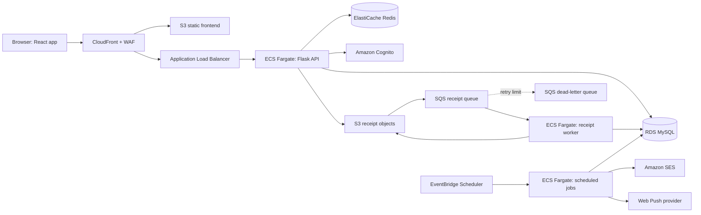

# HomeWallet

HomeWallet is a household finance web app for tracking transactions, budgets,
recurring bills, receipts, notifications, and community posts. The repository
contains a React/Vite frontend, a Flask API and scheduled jobs, OCR tooling, and
Terraform for the AWS development environment.

## Contents

- [Architecture](#architecture)
- [Prerequisites](#prerequisites)
- [Run the frontend with mock data](#run-the-frontend-with-mock-data)
- [Run against the AWS development API](#run-against-the-aws-development-api)
- [Run the API locally](#run-the-api-locally)
- [Checks](#checks)
- [Deploy](#deploy)
- [Configuration and security](#configuration-and-security)
- [Costs and limits](#costs-and-limits)
- [Production readiness](docs/production-readiness.md)
- [Project status and runbooks](#project-status-and-runbooks)

## Architecture



The dev environment is in `ap-southeast-1` (Singapore). Terraform lives in
`infra/envs/dev` and reusable modules live in `infra/modules`. The API and
receipt worker use the backend Docker image. Scheduled jobs use the same image
with a job-specific command. The Terraform default keeps recurring schedules
disabled.

The live AWS deployment is still **development**. The production hardening
profile is opt-in and has not been applied. The selected rollout keeps the
existing AWS account and CloudFront URL, with an HTTPS API Gateway origin and
private VPC Link to the ALB; a purchased domain is optional. See the
[readiness status](docs/production-readiness.md) and
[release runbook](docs/production-rollout.md) before promoting this stack.

## Prerequisites

- Git
- Python 3.12
- Node.js 24 and npm
- Docker Desktop, for local MySQL and integration checks
- AWS CLI and Terraform 1.10 or newer, only for AWS-backed development or
  infrastructure work
- An AWS identity authorized by the group; do not share credentials between
  team members

Commands below use Windows PowerShell. Run them from the repository root unless
the command changes directory explicitly.

## Run the frontend with mock data

This mode uses browser-local sample data and does not require AWS credentials or
a running API:

```powershell
cd frontend
npm ci
npm run dev:mock
```

Open the local Vite URL printed in the terminal. To create and inspect a
production-style static bundle locally, run `npm run build`; Vite writes it to
`frontend/dist`.

## Run against the AWS development API

This starts the frontend locally while sending `/api` requests to the dev API
through CloudFront. It requires group-approved AWS access and initialized
Terraform state so the helper can read the public Cognito and endpoint outputs.

```powershell
. .\scripts\dev.ps1
Test-DevSetup
Push-Location .\infra\envs\dev
terraform init
Pop-Location
Write-DevEnvFiles
cd frontend
npm ci
npm run dev
```

`Write-DevEnvFiles` creates ignored files at `backend/.env` and
`frontend/.env.local`; it does not print or commit credentials. The default
frontend API target is the dev CloudFront URL. Restart Vite after changing
`.env.local`. Use only test accounts and test data when exercising the shared
dev environment.

## Run the API locally

The local API uses MySQL on `localhost:3307`. This example creates a disposable
local-only database container; the password is for local development and must
not be reused in AWS:

```powershell
docker run -d --name hw-mysql -p 3307:3306 `
  -e MYSQL_ROOT_PASSWORD=devpass mysql:8.4

. .\scripts\dev.ps1
Write-DevEnvFiles -LocalApi

cd backend
py -3.12 -m venv .venv
.\.venv\Scripts\Activate.ps1
python -m pip install -r requirements-dev.txt
python -m jobs.migrate
python -m flask --app app.main:app run --host 127.0.0.1 --port 5000
```

In a second terminal, run `npm run dev` from `frontend`. The helper configures
the Vite proxy to use `http://localhost:5000`. The database starts empty;
features that require Cognito, S3, Gemini, SES, or Web Push need their own
approved development configuration. Do not copy production data into this
database.

Stop the local database with `docker stop hw-mysql`; use `docker start hw-mysql`
to resume it. The container keeps its local database files until it is removed.

## Checks

These are the checks used by CI. Run them from the listed directories.

Frontend:

```powershell
cd frontend
npm ci
npm run lint
npm test
npm run build
```

Backend:

```powershell
cd backend
py -3.12 -m venv .venv
.\.venv\Scripts\Activate.ps1
python -m pip install -r requirements-dev.txt
python -m pytest -ra
```

The optional MySQL community integration cases need a local MySQL 8.4 instance
on port 3307. See `.github/workflows/ci.yml` for the CI service and environment
variables. The OCR access and pilot guard checks are offline unit tests:

```powershell
cd ocr-lab
py -3.12 -m pip install -r requirements.txt
python -m unittest test_bedrock_access.py test_d3_pilot_v2.py -q
```

Terraform validation in CI runs `terraform fmt -check -recursive infra`, then
initializes without a remote backend and validates `infra/envs/dev`. Applying
Terraform is a separate infrastructure change and can create billable AWS
resources.

## Deploy

The `CI` workflow runs on pull requests and pushes to `main`. The `Deploy Dev`
workflow is manually started from GitHub Actions on `main`; it builds and pushes
the backend image, deploys the API, and restarts the receipt worker. It uses
GitHub OIDC and repository variables `AWS_ROLE_ARN`, `AWS_REGION`, and
`ECR_REPOSITORY`; the workflow restricts deployment to AWS account
`179923444714`.

`Deploy Dev` does not publish the frontend. Frontend publication is a separate
release step: build `frontend/dist`, use the authorized AWS role and the
Terraform outputs `frontend_bucket` and `cloudfront_distribution_id` to upload
the bundle and invalidate CloudFront. Review the target and plan before
publishing; do not use `aws s3 sync --delete` unless a reviewed release plan
specifically requires deletion.

Do not run `scripts/down.ps1` or its shell equivalent as routine cleanup. It
plans destruction of dev compute, data, and network resources; review the plan
and recovery impact before approving it.

## Configuration and security

- `scripts/dev.ps1` writes local environment files from Terraform outputs.
  `.env`, `.env.*`, `frontend/.env.local`, Terraform state/plans, local OCR
  images, and generated OCR reports are ignored by Git.
- Never commit API keys, passwords, access tokens, Cognito tokens, database
  passwords, VAPID private keys, receipt images, or unredacted request bodies.
  Public frontend settings use `VITE_*`; private server keys must never use that
  prefix.
- Use synthetic fixtures or explicitly approved test accounts. Do not use a
  household's real receipt as a benchmark fixture without authorization.
- API authentication uses Cognito JWTs. The browser SPA uses Cognito/Amplify;
  the API validates the configured issuer, JWKS, and client IDs.
- Read [the API contract](docs/api-contract.md),
  [community API contract](docs/community-api.md),
  [locale API](docs/locale-api.md), and
  [Web Push API](docs/web-push-api.md) before changing those interfaces.

## Costs and limits

There is no single monthly estimate in this repository: the bill depends on
region, resource uptime, traffic, stored receipt versions, model usage, email,
and data transfer. The dev stack includes ongoing cost drivers such as NAT,
load balancing, RDS, Redis, Fargate, WAF, CloudFront, S3, logs, and ECR. Model
and notification costs vary with requests. EventBridge recurring jobs default
to disabled (`job_schedules_enabled = false`); enabling them changes operational
behavior and can generate email or push notifications.

For a dated estimate, use the [AWS Pricing Calculator](https://calculator.aws/)
with the Singapore region and the current Terraform resource sizes, then compare
it with the account's Cost Explorer for actual charges. Check model-specific
rates at the official [Amazon Bedrock pricing page](https://aws.amazon.com/bedrock/pricing/)
and [Gemini API pricing page](https://ai.google.dev/gemini-api/docs/pricing/).
References checked **2026-11-11**; prices, service availability, and usage
limits can change. Do not treat OCR pilot token estimates as a full-stack monthly
estimate or as the AWS invoice.

## Project status and runbooks

Acceptance results and limitations are recorded under `docs/acceptance/`.
Current open work and handoff notes:

- [Team open work](docs/acceptance/team-open-work-20261110.md)
- [D3 / #34 Bedrock remediation and benchmark limits](docs/acceptance/34-bedrock-remediation-20261110.md)
- [#39 receipt recovery and external-data disposition](docs/acceptance/33-receipt1-recovery-20261110.md)
- [#25 / #37 budget acceptance](docs/acceptance/25-37-budget-20261110.md)
- [#43 email, Scheduler, and push acceptance](docs/acceptance/43-final-acceptance-20261110.md)
- [Local workspace and merge notes](docs/local-workspace.md)
- [Scheduled job commands](backend/jobs/README.md)

Some acceptance evidence is intentionally retained outside the repository by
the team. Weekly DOCX work guides are local-only and are not part of the GitHub
handoff.

The environment templates are [`backend/.env.example`](backend/.env.example)
and [`frontend/.env.example`](frontend/.env.example); they contain placeholders
only. For the current D5 working pack, see
[`d5-final-delivery-20261109.md`](docs/acceptance/d5-final-delivery-20261109.md),
[`d5-cost-appendix-20261109.md`](docs/acceptance/d5-cost-appendix-20261109.md),
[`d5-app-comparison-20261109.md`](docs/acceptance/d5-app-comparison-20261109.md),
and [`d5-slides-outline-20261109.md`](docs/acceptance/d5-slides-outline-20261109.md).
